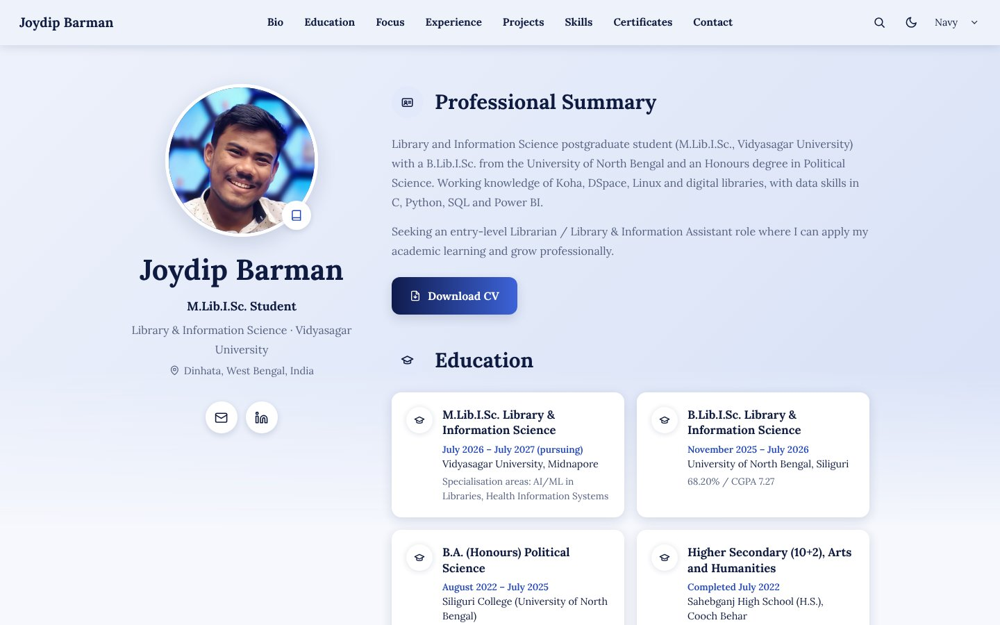

# Joydip Barman: Portfolio

**Live site: [joydipbarman.github.io](https://joydipbarman.github.io)**



## About

This is the personal portfolio of **Joydip Barman**, an M.Lib.I.Sc. student (Library & Information Science) at Vidyasagar University, with a B.Lib.I.Sc. from the University of North Bengal and a B.A. (Honours) in Political Science.

I am looking for an entry-level **Librarian / Library & Information Assistant** role. The site brings together my education, skills, certificates and the library systems I have worked with, in one place that is easy to share.

## What is on the site

| Section | What it shows |
| --- | --- |
| Bio | Professional summary and a CV download button |
| Education | M.Lib.I.Sc., B.Lib.I.Sc., B.A. (Honours) and Higher Secondary, with marks |
| Interests | Academic interests and interests outside the classroom |
| Focus | A short statement of what I work on and what I am looking for |
| Experience | Fresher status and project work, plus NCC cadet service |
| Projects | The Departmental Mini OPAC System, with a screenshot and live link |
| Skills | Library software (Koha, DSpace), LIS topics, data and programming, computer skills, languages |
| Certificates & Achievements | Workshops, seminars and online courses, newest first |
| Contact | Email, LinkedIn and CV download |

## Featured project

**Departmental Mini OPAC System** is an online public access catalogue for the Department of English, Vidyasagar University. Google Sheets holds the catalogue and Google Apps Script provides the logic and interface. Users can search by title, author, ISBN, accession number, subject or call number and filter by collection.

Live catalogue: <https://tinyurl.com/vuenglib>

## Features

- Single responsive page that works on phones, tablets and desktops
- Four colour themes (Navy, Coffee, Indigo, Forest), each with a light and a dark mode; the choice is remembered in the browser
- Built-in search that highlights matching items across the whole page
- No framework and no build step: plain HTML, CSS and a little JavaScript
- Optimised images (JPEG and WebP) and lazy loading for the project screenshot
- Semantic HTML, image descriptions and support for reduced motion

## Tech stack

HTML5 · CSS3 (custom properties for theming) · vanilla JavaScript · [Lora](https://fonts.google.com/specimen/Lora) font · hosted on GitHub Pages

## Repository structure

```text
.
├── index.html              Page content and structure
├── style.css               Layout, themes and responsive rules
├── script.js               Theme, dark mode and search
├── Joydip_Barman_CV.pdf    CV used by the Download CV buttons
├── images/
│   ├── joydip.jpg          Profile photo
│   ├── opac.webp           Screenshot of the Mini OPAC
│   └── preview.jpg         Preview image used in this README
├── README.md
├── LICENSE                 MIT licence (code only)
└── NOTICE.md               Content rights and third-party credits
```

## Run it locally

No installation is needed. Open `index.html` in a browser, or serve the folder:

```bash
python3 -m http.server 8000
# then visit http://localhost:8000
```

## Update the content

- **Text:** edit `index.html`. Each section has an `id` (`bio`, `education`, `focus`, `experience`, `projects`, `skills`, `certifications`, `contact`).
- **New certificate:** copy one `<li class="searchable">` inside `<ul class="certs">`, newest first.
- **New project:** copy the `<article class="proj searchable">` block in the Projects section.
- **Photo or CV:** replace `images/joydip.jpg` or `Joydip_Barman_CV.pdf` and keep the same file names.
- **Colours:** edit the theme blocks at the top of `style.css`.

## Deploy

The repository is named `joydipbarman.github.io`, so GitHub Pages serves it at <https://joydipbarman.github.io>. Pages is set to deploy from the `main` branch, root folder (Settings > Pages). Every push to `main` updates the site within a minute or two.

## Contact

- Email: [joydipbarman.work@gmail.com](mailto:joydipbarman.work@gmail.com)
- LinkedIn: [linkedin.com/in/joydipbarman](https://www.linkedin.com/in/joydipbarman)

## License

- **Code** (HTML structure, `style.css`, `script.js`): [MIT License](LICENSE). You are welcome to reuse the design; please keep the copyright notice.
- **Personal content** (photo, CV, written text, screenshots, contact details): © 2026 Joydip Barman, all rights reserved. See [NOTICE.md](NOTICE.md), which also lists third-party credits.

If you use this site as a template, replace all personal content with your own.
